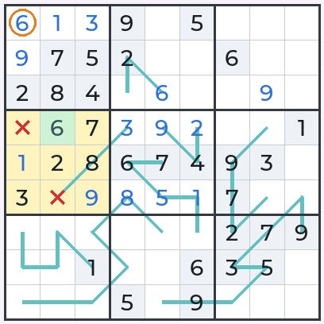

<!-- Written by tools/walkthrough.py modular-lines: edit the script, not this page. -->
# Modular Lines, step 15: the 6 in box 4

**Step 15 of 52** · [← Step 14](step-14.md) · [All steps](../modular-lines.md#the-whole-puzzle-step-by-step) · [Step 16 →](step-16.md)

Box 4 needs a 6. r4c1: column 1 has one (r1c1). r6c2: next to it on its teal line there's one of 3 6 9 and one of 2 5 8 already, and three in a row need one of each. Only **r4c2** is left: **r4c2 = 6**.

**Step 15 of 52** · [← Step 14](step-14.md) · [All steps](../modular-lines.md#the-whole-puzzle-step-by-step) · [Step 16 →](step-16.md)
