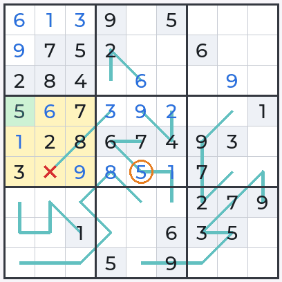

<!-- Written by tools/walkthrough.py modular-lines: edit the script, not this page. -->
# Modular Lines, step 16: the 5 in box 4

**Step 16 of 52** · [← Step 15](step-15.md) · [All steps](../modular-lines.md#the-whole-puzzle-step-by-step) · [Step 17 →](step-17.md)

Box 4 needs a 5. r6c2: row 6 has one (r6c5). Only **r4c1** is left: **r4c1 = 5**.

**Step 16 of 52** · [← Step 15](step-15.md) · [All steps](../modular-lines.md#the-whole-puzzle-step-by-step) · [Step 17 →](step-17.md)
