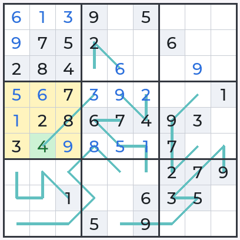

<!-- Written by tools/walkthrough.py modular-lines: edit the script, not this page. -->
# Modular Lines, step 17: the 4 in box 4

**Step 17 of 52** · [← Step 16](step-16.md) · [All steps](../modular-lines.md#the-whole-puzzle-step-by-step) · [Step 18 →](step-18.md)

Box 4 needs a 4, and r6c2 is its last empty cell: **r6c2 = 4**.

**Step 17 of 52** · [← Step 16](step-16.md) · [All steps](../modular-lines.md#the-whole-puzzle-step-by-step) · [Step 18 →](step-18.md)
