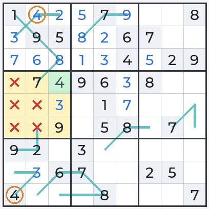

<!-- Written by tools/walkthrough.py modular-lines: edit the script, not this page. -->
# Modular Lines, step 18: the 2 in box 6

**Step 18 of 52** · [← Step 17](step-17.md) · [All steps](../modular-lines.md#the-whole-puzzle-step-by-step) · [Step 19 →](step-19.md)

Box 6 needs a 2. r4c7 and r4c8: row 4 has one (r4c6). r5c9: row 5 has one (r5c2). r6c8: it's 3 cells from the 9 in r5c7 along its teal line, so it's one of 3 6 9 like it. Only **r6c9** is left: **r6c9 = 2**.

**Step 18 of 52** · [← Step 17](step-17.md) · [All steps](../modular-lines.md#the-whole-puzzle-step-by-step) · [Step 19 →](step-19.md)
