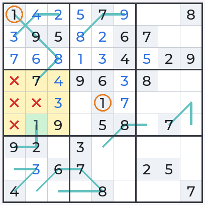

<!-- Written by tools/walkthrough.py modular-lines: edit the script, not this page. -->
# Modular Lines, step 19: the 2 in box 3

**Step 19 of 52** · [← Step 18](step-18.md) · [All steps](../modular-lines.md#the-whole-puzzle-step-by-step) · [Step 20 →](step-20.md)

Box 3 needs a 2. r1c7: column 7 has one (r7c7). r1c9: column 9 has one (r6c9). r2c8 and r2c9: row 2 has one (r2c4). r3c7 and r3c9: row 3 has one (r3c1). Only **r1c8** is left: **r1c8 = 2**.

**Step 19 of 52** · [← Step 18](step-18.md) · [All steps](../modular-lines.md#the-whole-puzzle-step-by-step) · [Step 20 →](step-20.md)
