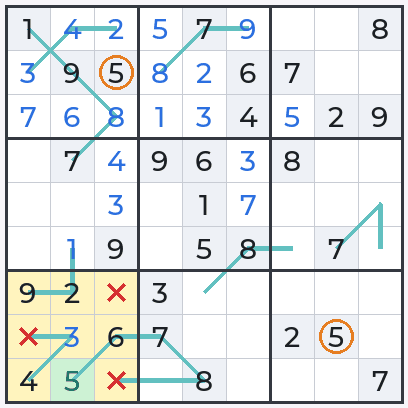

<!-- Written by tools/walkthrough.py modular-lines: edit the script, not this page. -->
# Modular Lines, step 20: the 4 in box 6

**Step 20 of 52** · [← Step 19](step-19.md) · [All steps](../modular-lines.md#the-whole-puzzle-step-by-step) · [Step 21 →](step-21.md)

Box 6 needs a 4. r5c9: row 5 has one (r5c6). r6c8: row 6 has one (r6c2). r4c8: it's 3 cells from the 2 in r7c7 along its teal line, so it's one of 2 5 8 like it. Only **r4c7** is left: **r4c7 = 4**.

**Step 20 of 52** · [← Step 19](step-19.md) · [All steps](../modular-lines.md#the-whole-puzzle-step-by-step) · [Step 21 →](step-21.md)
