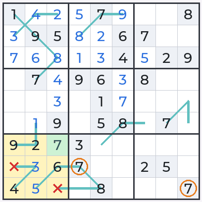

<!-- Written by tools/walkthrough.py modular-lines: edit the script, not this page. -->
# Modular Lines, step 21: the 5 in box 6

**Step 21 of 52** · [← Step 20](step-20.md) · [All steps](../modular-lines.md#the-whole-puzzle-step-by-step) · [Step 22 →](step-22.md)

Box 6 needs a 5. r4c8: row 4 has one (r4c1). r6c8: row 6 has one (r6c5). Only **r5c9** is left: **r5c9 = 5**.

**Step 21 of 52** · [← Step 20](step-20.md) · [All steps](../modular-lines.md#the-whole-puzzle-step-by-step) · [Step 22 →](step-22.md)
