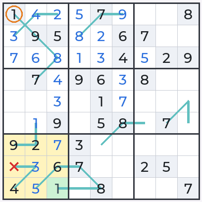

<!-- Written by tools/walkthrough.py modular-lines: edit the script, not this page. -->
# Modular Lines, step 22: the 5 in box 3

**Step 22 of 52** · [← Step 21](step-21.md) · [All steps](../modular-lines.md#the-whole-puzzle-step-by-step) · [Step 23 →](step-23.md)

Box 3 needs a 5. r1c7 and r1c9: row 1 has one (r1c6). r2c8 and r2c9: row 2 has one (r2c3). r3c9: column 9 has one (r5c9). Only **r3c7** is left: **r3c7 = 5**.

**Step 22 of 52** · [← Step 21](step-21.md) · [All steps](../modular-lines.md#the-whole-puzzle-step-by-step) · [Step 23 →](step-23.md)
