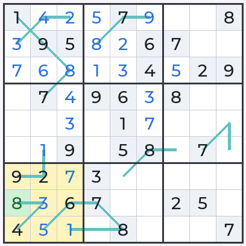

<!-- Written by tools/walkthrough.py modular-lines: edit the script, not this page. -->
# Modular Lines, step 23: the 1 in box 3

**Step 23 of 52** · [← Step 22](step-22.md) · [All steps](../modular-lines.md#the-whole-puzzle-step-by-step) · [Step 24 →](step-24.md)

Box 3 needs a 1. r1c7 and r1c9: row 1 has one (r1c2). r2c9 and r3c9: column 9 has one (r4c9). Only **r2c8** is left: **r2c8 = 1**.

**Step 23 of 52** · [← Step 22](step-22.md) · [All steps](../modular-lines.md#the-whole-puzzle-step-by-step) · [Step 24 →](step-24.md)
