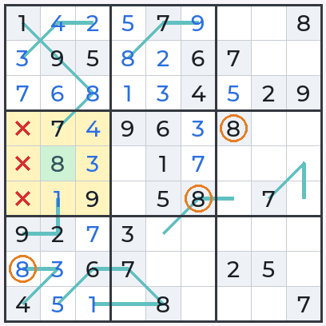

<!-- Written by tools/walkthrough.py modular-lines: edit the script, not this page. -->
# Modular Lines, step 24: the 1 in box 2

**Step 24 of 52** · [← Step 23](step-23.md) · [All steps](../modular-lines.md#the-whole-puzzle-step-by-step) · [Step 25 →](step-25.md)

Box 2 needs a 1. r1c5: row 1 has one (r1c2). r2c5 and r2c6: row 2 has one (r2c8). r3c6: column 6 has one (r6c6). Only **r3c4** is left: **r3c4 = 1**.

**Step 24 of 52** · [← Step 23](step-23.md) · [All steps](../modular-lines.md#the-whole-puzzle-step-by-step) · [Step 25 →](step-25.md)
