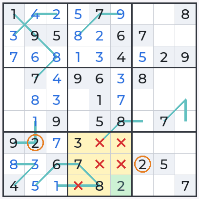

<!-- Written by tools/walkthrough.py modular-lines: edit the script, not this page. -->
# Modular Lines, step 25: the 7 in box 2

**Step 25 of 52** · [← Step 24](step-24.md) · [All steps](../modular-lines.md#the-whole-puzzle-step-by-step) · [Step 26 →](step-26.md)

Box 2 needs a 7. r1c5: column 5 has one (r5c5). r2c5 and r2c6: row 2 has one (r2c2). Only **r3c6** is left: **r3c6 = 7**.

**Step 25 of 52** · [← Step 24](step-24.md) · [All steps](../modular-lines.md#the-whole-puzzle-step-by-step) · [Step 26 →](step-26.md)
