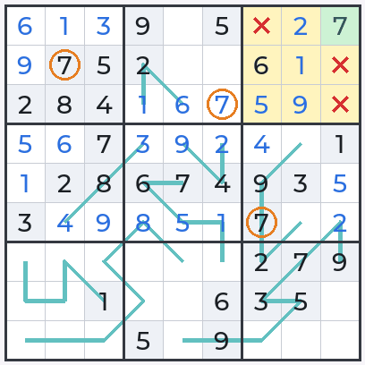

<!-- Written by tools/walkthrough.py modular-lines: edit the script, not this page. -->
# Modular Lines, step 26: the 7 in box 3

**Step 26 of 52** · [← Step 25](step-25.md) · [All steps](../modular-lines.md#the-whole-puzzle-step-by-step) · [Step 27 →](step-27.md)

Box 3 needs a 7. r1c7: column 7 has one (r6c7). r2c9: row 2 has one (r2c2). r3c9: row 3 has one (r3c6). Only **r1c9** is left: **r1c9 = 7**.

**Step 26 of 52** · [← Step 25](step-25.md) · [All steps](../modular-lines.md#the-whole-puzzle-step-by-step) · [Step 27 →](step-27.md)
