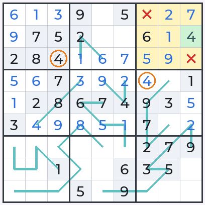

<!-- Written by tools/walkthrough.py modular-lines: edit the script, not this page. -->
# Modular Lines, step 27: the 4 in box 3

**Step 27 of 52** · [← Step 26](step-26.md) · [All steps](../modular-lines.md#the-whole-puzzle-step-by-step) · [Step 28 →](step-28.md)

Box 3 needs a 4. r1c7: column 7 has one (r4c7). r3c9: row 3 has one (r3c3). Only **r2c9** is left: **r2c9 = 4**.

**Step 27 of 52** · [← Step 26](step-26.md) · [All steps](../modular-lines.md#the-whole-puzzle-step-by-step) · [Step 28 →](step-28.md)
