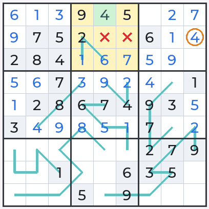

<!-- Written by tools/walkthrough.py modular-lines: edit the script, not this page. -->
# Modular Lines, step 28: the 4 in box 2

**Step 28 of 52** · [← Step 27](step-27.md) · [All steps](../modular-lines.md#the-whole-puzzle-step-by-step) · [Step 29 →](step-29.md)

Box 2 needs a 4. r2c5 and r2c6: row 2 has one (r2c9). Only **r1c5** is left: **r1c5 = 4**.

**Step 28 of 52** · [← Step 27](step-27.md) · [All steps](../modular-lines.md#the-whole-puzzle-step-by-step) · [Step 29 →](step-29.md)
