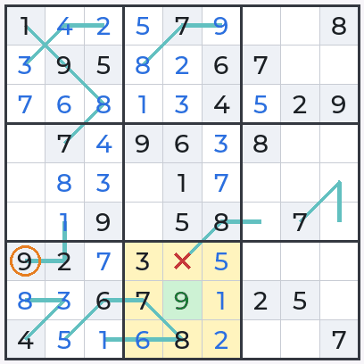

<!-- Written by tools/walkthrough.py modular-lines: edit the script, not this page. -->
# Modular Lines, step 29: the 3 in box 3

**Step 29 of 52** · [← Step 28](step-28.md) · [All steps](../modular-lines.md#the-whole-puzzle-step-by-step) · [Step 30 →](step-30.md)

Box 3 needs a 3. r1c7: row 1 has one (r1c3). Only **r3c9** is left: **r3c9 = 3**.

**Step 29 of 52** · [← Step 28](step-28.md) · [All steps](../modular-lines.md#the-whole-puzzle-step-by-step) · [Step 30 →](step-30.md)
