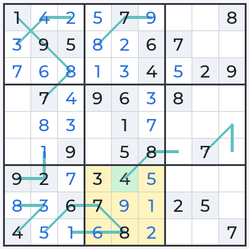

<!-- Written by tools/walkthrough.py modular-lines: edit the script, not this page. -->
# Modular Lines, step 30: the 8 in box 3

**Step 30 of 52** · [← Step 29](step-29.md) · [All steps](../modular-lines.md#the-whole-puzzle-step-by-step) · [Step 31 →](step-31.md)

Box 3 needs an 8, and r1c7 is its last empty cell: **r1c7 = 8**.

**Step 30 of 52** · [← Step 29](step-29.md) · [All steps](../modular-lines.md#the-whole-puzzle-step-by-step) · [Step 31 →](step-31.md)
