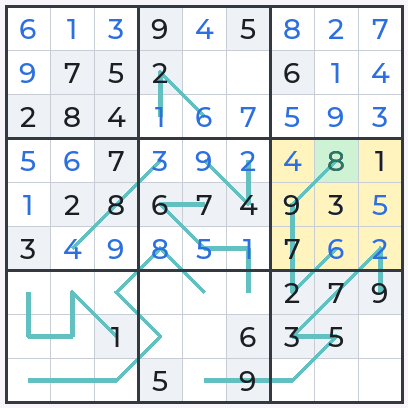

<!-- Written by tools/walkthrough.py modular-lines: edit the script, not this page. -->
# Modular Lines, step 32: the 8 in box 6

**Step 32 of 52** · [← Step 31](step-31.md) · [All steps](../modular-lines.md#the-whole-puzzle-step-by-step) · [Step 33 →](step-33.md)

Box 6 needs an 8, and r4c8 is its last empty cell: **r4c8 = 8**.

**Step 32 of 52** · [← Step 31](step-31.md) · [All steps](../modular-lines.md#the-whole-puzzle-step-by-step) · [Step 33 →](step-33.md)
