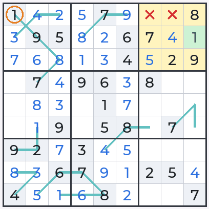

<!-- Written by tools/walkthrough.py modular-lines: edit the script, not this page. -->
# Modular Lines, step 33: the 2 in box 7

**Step 33 of 52** · [← Step 32](step-32.md) · [All steps](../modular-lines.md#the-whole-puzzle-step-by-step) · [Step 34 →](step-34.md)

Box 7 needs a 2. r7c1, r7c2 and r7c3: row 7 has one (r7c7). r8c1 and r9c1: column 1 has one (r3c1). r8c2 and r9c2: column 2 has one (r5c2). Only **r9c3** is left: **r9c3 = 2**.

**Step 33 of 52** · [← Step 32](step-32.md) · [All steps](../modular-lines.md#the-whole-puzzle-step-by-step) · [Step 34 →](step-34.md)
