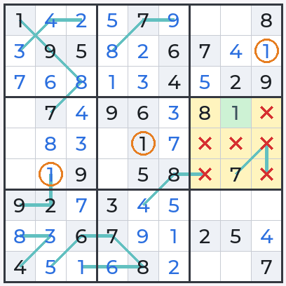

<!-- Written by tools/walkthrough.py modular-lines: edit the script, not this page. -->
# Modular Lines, step 34: the 5 in box 7

**Step 34 of 52** · [← Step 33](step-33.md) · [All steps](../modular-lines.md#the-whole-puzzle-step-by-step) · [Step 35 →](step-35.md)

Box 7 needs a 5. r7c1: column 1 has one (r4c1). r7c3: column 3 has one (r2c3). r8c1 and r8c2: row 8 has one (r8c8). r9c1 and r9c2: row 9 has one (r9c4). Only **r7c2** is left: **r7c2 = 5**.

**Step 34 of 52** · [← Step 33](step-33.md) · [All steps](../modular-lines.md#the-whole-puzzle-step-by-step) · [Step 35 →](step-35.md)
