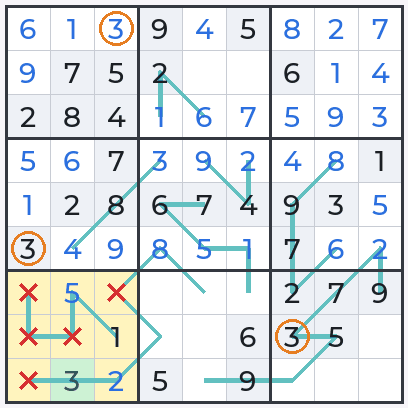

<!-- Written by tools/walkthrough.py modular-lines: edit the script, not this page. -->
# Modular Lines, step 35: the 3 in box 7

**Step 35 of 52** · [← Step 34](step-34.md) · [All steps](../modular-lines.md#the-whole-puzzle-step-by-step) · [Step 36 →](step-36.md)

Box 7 needs a 3. r7c1 and r9c1: column 1 has one (r6c1). r7c3: column 3 has one (r1c3). r8c1 and r8c2: row 8 has one (r8c7). Only **r9c2** is left: **r9c2 = 3**.

**Step 35 of 52** · [← Step 34](step-34.md) · [All steps](../modular-lines.md#the-whole-puzzle-step-by-step) · [Step 36 →](step-36.md)
