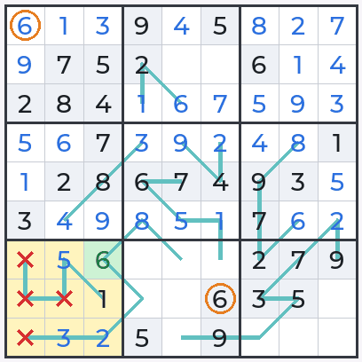

<!-- Written by tools/walkthrough.py modular-lines: edit the script, not this page. -->
# Modular Lines, step 36: the 6 in box 7

**Step 36 of 52** · [← Step 35](step-35.md) · [All steps](../modular-lines.md#the-whole-puzzle-step-by-step) · [Step 37 →](step-37.md)

Box 7 needs a 6. r7c1 and r9c1: column 1 has one (r1c1). r8c1 and r8c2: row 8 has one (r8c6). Only **r7c3** is left: **r7c3 = 6**.

**Step 36 of 52** · [← Step 35](step-35.md) · [All steps](../modular-lines.md#the-whole-puzzle-step-by-step) · [Step 37 →](step-37.md)
