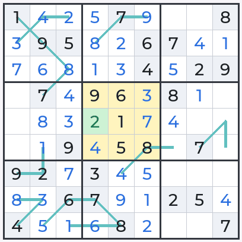

<!-- Written by tools/walkthrough.py modular-lines: edit the script, not this page. -->
# Modular Lines, step 37: the 8 in box 7

**Step 37 of 52** · [← Step 36](step-36.md) · [All steps](../modular-lines.md#the-whole-puzzle-step-by-step) · [Step 38 →](step-38.md)

Box 7 needs an 8. r8c2: column 2 has one (r3c2). r8c1: it's 3 cells from the 1 in r8c3 along its teal line, so it's one of 1 4 7 like it. r9c1: next to it on its teal line there's one of 3 6 9 and one of 2 5 8 already, and three in a row need one of each. Only **r7c1** is left: **r7c1 = 8**.

**Step 37 of 52** · [← Step 36](step-36.md) · [All steps](../modular-lines.md#the-whole-puzzle-step-by-step) · [Step 38 →](step-38.md)
