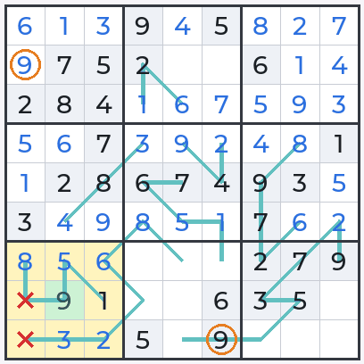

<!-- Written by tools/walkthrough.py modular-lines: edit the script, not this page. -->
# Modular Lines, step 38: the 9 in box 7

**Step 38 of 52** · [← Step 37](step-37.md) · [All steps](../modular-lines.md#the-whole-puzzle-step-by-step) · [Step 39 →](step-39.md)

Box 7 needs a 9. r8c1: column 1 has one (r2c1). r9c1: row 9 has one (r9c6). Only **r8c2** is left: **r8c2 = 9**.

**Step 38 of 52** · [← Step 37](step-37.md) · [All steps](../modular-lines.md#the-whole-puzzle-step-by-step) · [Step 39 →](step-39.md)
