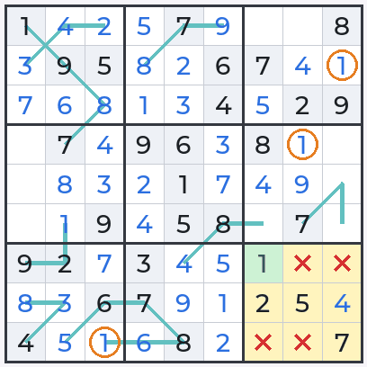

<!-- Written by tools/walkthrough.py modular-lines: edit the script, not this page. -->
# Modular Lines, step 39: the 1 in box 8

**Step 39 of 52** · [← Step 38](step-38.md) · [All steps](../modular-lines.md#the-whole-puzzle-step-by-step) · [Step 40 →](step-40.md)

Box 8 needs a 1. r7c4: column 4 has one (r3c4). r7c6: column 6 has one (r6c6). r8c4 and r8c5: row 8 has one (r8c3). r9c5: it's 3 cells from the 5 in r8c8 along its teal line, so it's one of 2 5 8 like it. Only **r7c5** is left: **r7c5 = 1**.

**Step 39 of 52** · [← Step 38](step-38.md) · [All steps](../modular-lines.md#the-whole-puzzle-step-by-step) · [Step 40 →](step-40.md)
