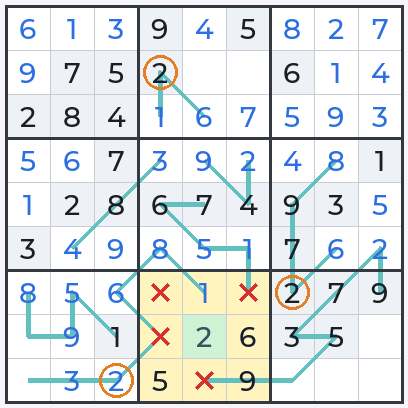

<!-- Written by tools/walkthrough.py modular-lines: edit the script, not this page. -->
# Modular Lines, step 40: the 2 in box 8

**Step 40 of 52** · [← Step 39](step-39.md) · [All steps](../modular-lines.md#the-whole-puzzle-step-by-step) · [Step 41 →](step-41.md)

Box 8 needs a 2. r7c4 and r7c6: row 7 has one (r7c7). r8c4: column 4 has one (r2c4). r9c5: row 9 has one (r9c3). Only **r8c5** is left: **r8c5 = 2**.

**Step 40 of 52** · [← Step 39](step-39.md) · [All steps](../modular-lines.md#the-whole-puzzle-step-by-step) · [Step 41 →](step-41.md)
