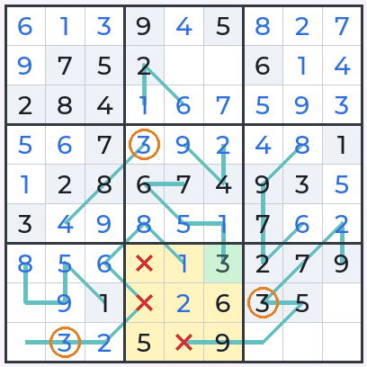

<!-- Written by tools/walkthrough.py modular-lines: edit the script, not this page. -->
# Modular Lines, step 41: the 3 in box 8

**Step 41 of 52** · [← Step 40](step-40.md) · [All steps](../modular-lines.md#the-whole-puzzle-step-by-step) · [Step 42 →](step-42.md)

Box 8 needs a 3. r7c4: column 4 has one (r4c4). r8c4: row 8 has one (r8c7). r9c5: row 9 has one (r9c2). Only **r7c6** is left: **r7c6 = 3**.

**Step 41 of 52** · [← Step 40](step-40.md) · [All steps](../modular-lines.md#the-whole-puzzle-step-by-step) · [Step 42 →](step-42.md)
