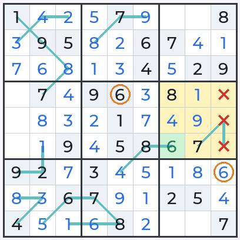

<!-- Written by tools/walkthrough.py modular-lines: edit the script, not this page. -->
# Modular Lines, step 42: the 3 in box 2

**Step 42 of 52** · [← Step 41](step-41.md) · [All steps](../modular-lines.md#the-whole-puzzle-step-by-step) · [Step 43 →](step-43.md)

Box 2 needs a 3. r2c6: column 6 has one (r7c6). Only **r2c5** is left: **r2c5 = 3**.

**Step 42 of 52** · [← Step 41](step-41.md) · [All steps](../modular-lines.md#the-whole-puzzle-step-by-step) · [Step 43 →](step-43.md)
