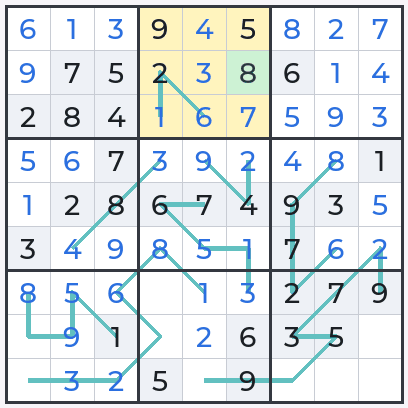

<!-- Written by tools/walkthrough.py modular-lines: edit the script, not this page. -->
# Modular Lines, step 43: the 8 in box 2

**Step 43 of 52** · [← Step 42](step-42.md) · [All steps](../modular-lines.md#the-whole-puzzle-step-by-step) · [Step 44 →](step-44.md)

Box 2 needs an 8, and r2c6 is its last empty cell: **r2c6 = 8**.

**Step 43 of 52** · [← Step 42](step-42.md) · [All steps](../modular-lines.md#the-whole-puzzle-step-by-step) · [Step 44 →](step-44.md)
