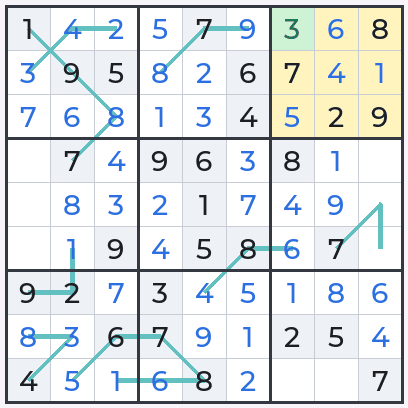

<!-- Written by tools/walkthrough.py modular-lines: edit the script, not this page. -->
# Modular Lines, step 44: the 7 in box 8

**Step 44 of 52** · [← Step 43](step-43.md) · [All steps](../modular-lines.md#the-whole-puzzle-step-by-step) · [Step 45 →](step-45.md)

Box 8 needs a 7. r7c4: row 7 has one (r7c8). r9c5: column 5 has one (r5c5). Only **r8c4** is left: **r8c4 = 7**.

**Step 44 of 52** · [← Step 43](step-43.md) · [All steps](../modular-lines.md#the-whole-puzzle-step-by-step) · [Step 45 →](step-45.md)
