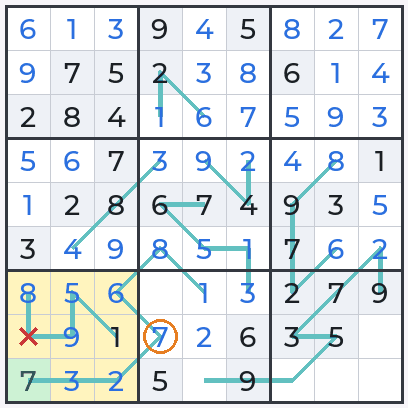

<!-- Written by tools/walkthrough.py modular-lines: edit the script, not this page. -->
# Modular Lines, step 45: the 7 in box 7

**Step 45 of 52** · [← Step 44](step-44.md) · [All steps](../modular-lines.md#the-whole-puzzle-step-by-step) · [Step 46 →](step-46.md)

Box 7 needs a 7. r8c1: row 8 has one (r8c4). Only **r9c1** is left: **r9c1 = 7**.

**Step 45 of 52** · [← Step 44](step-44.md) · [All steps](../modular-lines.md#the-whole-puzzle-step-by-step) · [Step 46 →](step-46.md)
