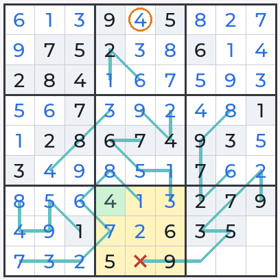

<!-- Written by tools/walkthrough.py modular-lines: edit the script, not this page. -->
# Modular Lines, step 47: the 4 in box 8

**Step 47 of 52** · [← Step 46](step-46.md) · [All steps](../modular-lines.md#the-whole-puzzle-step-by-step) · [Step 48 →](step-48.md)

Box 8 needs a 4. r9c5: column 5 has one (r1c5). Only **r7c4** is left: **r7c4 = 4**.

**Step 47 of 52** · [← Step 46](step-46.md) · [All steps](../modular-lines.md#the-whole-puzzle-step-by-step) · [Step 48 →](step-48.md)
