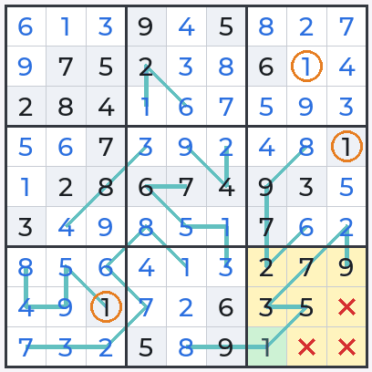

<!-- Written by tools/walkthrough.py modular-lines: edit the script, not this page. -->
# Modular Lines, step 49: the 1 in box 9

**Step 49 of 52** · [← Step 48](step-48.md) · [All steps](../modular-lines.md#the-whole-puzzle-step-by-step) · [Step 50 →](step-50.md)

Box 9 needs a 1. r8c9: row 8 has one (r8c3). r9c8: column 8 has one (r2c8). r9c9: column 9 has one (r4c9). Only **r9c7** is left: **r9c7 = 1**.

**Step 49 of 52** · [← Step 48](step-48.md) · [All steps](../modular-lines.md#the-whole-puzzle-step-by-step) · [Step 50 →](step-50.md)
