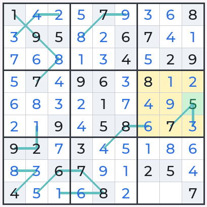

<!-- Written by tools/walkthrough.py modular-lines: edit the script, not this page. -->
# Modular Lines, step 50: the 4 in box 9

**Step 50 of 52** · [← Step 49](step-49.md) · [All steps](../modular-lines.md#the-whole-puzzle-step-by-step) · [Step 51 →](step-51.md)

Box 9 needs a 4. r8c9: row 8 has one (r8c1). r9c9: column 9 has one (r2c9). Only **r9c8** is left: **r9c8 = 4**.

**Step 50 of 52** · [← Step 49](step-49.md) · [All steps](../modular-lines.md#the-whole-puzzle-step-by-step) · [Step 51 →](step-51.md)
