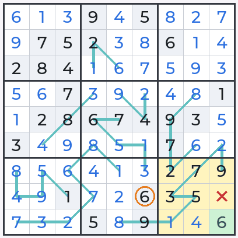

<!-- Written by tools/walkthrough.py modular-lines: edit the script, not this page. -->
# Modular Lines, step 51: the 6 in box 9

**Step 51 of 52** · [← Step 50](step-50.md) · [All steps](../modular-lines.md#the-whole-puzzle-step-by-step) · [Step 52 →](step-52.md)

Box 9 needs a 6. r8c9: row 8 has one (r8c6). Only **r9c9** is left: **r9c9 = 6**.

**Step 51 of 52** · [← Step 50](step-50.md) · [All steps](../modular-lines.md#the-whole-puzzle-step-by-step) · [Step 52 →](step-52.md)
