# Nabner

[← All variants](README.md) · [Puzzles](../features-puzzles.md) · [How to play](../how-to-play.md)

## The rules

[Classic](classic.md) rules, and **brown lines**: no two digits on a line are **the same or 1 apart**. That's every two digits on the line, not just neighbours: 1, 4, 8, 6 is fine (the closest pair, 8 and 6, is 2 apart), but 1, 4, 8, 3 isn't (4 and 3). A line has 3 to 5 cells: no six digits are all 2 or more apart.

## On the board

- The lines are drawn in brown, through the cell centres; lines don't cross each other.
- Two digits on a line that are the same or 1 apart turn red.
- The grader and hints treat a line as a set of digits that keep their distance: "No two digits on this line are the same or 1 apart, so row 4, column 6 can only be 2."
- **Puzzles → ⋮ → New puzzle → Lines → Nabner**: 8 lines (Hard and Expert: 10).

## How to solve it

- **Each digit on a line rules out itself and its neighbours** for every other cell of that line: a 5 leaves only 1 to 3 and 7 to 9.
- **A long line is a tight fit:** five cells need five digits all 2 apart, and only 1, 3, 5, 7, 9 do that: a 5-cell line is all odd. Four cells leave a few more sets (1, 3, 5, 7 or 2, 4, 6, 9 ...).
- **Low and high split:** a 4 and a 6 on one line leave no room for 3, 5 or 7 anywhere on it.

## Worked example

**variant-examples #43**, Nabner Easy (see [Classic](classic.md#worked-example-the-whole-puzzle) for how to import the examples; cells are written r*row*c*column*).

**Step 1: r4c6.** Row 4 has 5, 6, 9, 4 and 1; box 5 has the 7 in r5c5 and column 6 the 8 in r2c6: that leaves 2 and 3. r4c6 is on a line with r3c6, the 4 in r4c7 and the 9 in r5c7, and 3 is 1 away from that 4. **r4c6 = 2**.

**Step 2: r5c1.** Column 1 has 9, 5 and 3; row 5 has 8, 7 and 9; box 4 has 6: that leaves 1, 2 and 4. r5c1 is on a line with r7c1, r7c2 and the 3 in r6c1: 2 and 4 are both 1 away from it. **r5c1 = 1**.

**Step 3: r2c3**, by the Classic rules alone: box 1 needs a 5, rows 1 and 3 have one (r1c6, r3c7) and r2c1, r2c2 and r3c3 are filled. **r2c3 = 5**.

## The whole puzzle, step by step

<!-- walkthrough -->
<!-- Written by tools/walkthrough.py nabner: edit the script, not this part. -->

The whole puzzle, from the start to the last cell: 52 steps, each one a single (one place left for a digit, or one digit left for a cell), taken in the order a box's single comes first, so not quite the order of the worked example above. In each picture, the unit the step looks at is tinted yellow (for a cell with one digit left: its row, column and box), the new digit is on green, the digits that rule cells out have an **orange ring**, and the empty cells they rule out a **red cross**. Givens are on grey, digits from earlier steps in blue.

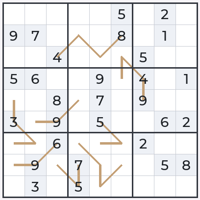

#### Step 1: the 5 in box 1

Box 1 needs a 5. r1c1, r1c2 and r1c3: row 1 has one (r1c6). r3c1 and r3c2: row 3 has one (r3c7). Only **r2c3** is left: **r2c3 = 5**.

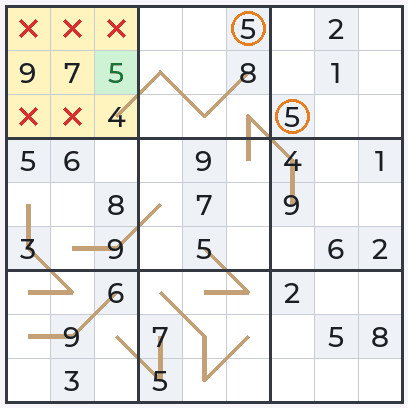

#### Step 2: the 3 in box 1

Box 1 needs a 3. r1c1 and r3c1: column 1 has one (r6c1). r1c2 and r3c2: column 2 has one (r9c2). Only **r1c3** is left: **r1c3 = 3**.

#### Step 3: the 7 in box 2

Box 2 needs a 7. r1c4 and r3c4: column 4 has one (r8c4). r1c5 and r3c5: column 5 has one (r5c5). r2c4 and r2c5: row 2 has one (r2c2). Only **r3c6** is left: **r3c6 = 7**.

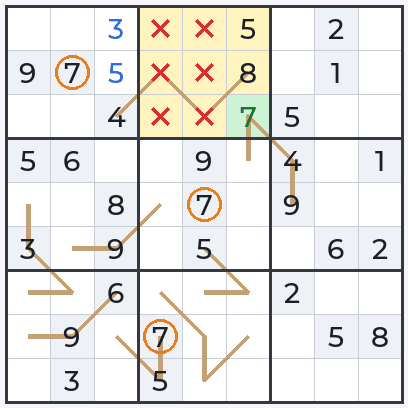

#### Step 4: the 7 in box 4

Box 4 needs a 7. r5c1 and r5c2: row 5 has one (r5c5). r6c2: column 2 has one (r2c2). Only **r4c3** is left: **r4c3 = 7**.

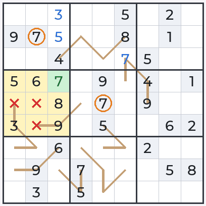

#### Step 5: the 2 in box 4

Box 4 needs a 2. r6c2: row 6 has one (r6c9). r5c1: the 3 in r6c1 is on its brown line too, and 2 is 1 away from it. Only **r5c2** is left: **r5c2 = 2**.

#### Step 6: the 2 in box 1

Box 1 needs a 2. r1c1 and r1c2: row 1 has one (r1c8). r3c2: column 2 has one (r5c2). Only **r3c1** is left: **r3c1 = 2**.

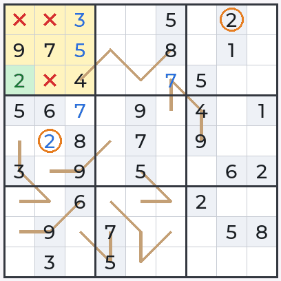

#### Step 7: the 6 in box 1

Box 1 needs a 6. r1c2 and r3c2: column 2 has one (r4c2). Only **r1c1** is left: **r1c1 = 6**.

#### Step 8: the 4 in box 4

Box 4 needs a 4. r5c1: the 3 in r6c1 is on its brown line too, and 4 is 1 away from it. Only **r6c2** is left: **r6c2 = 4**.

#### Step 9: the 1 in box 4

Box 4 needs a 1, and r5c1 is its last empty cell: **r5c1 = 1**.

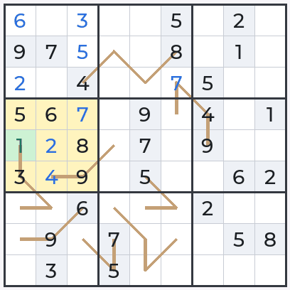

#### Step 10: the 4 in box 5

Box 5 needs a 4. r4c4 and r4c6: row 4 has one (r4c7). r6c4 and r6c6: row 6 has one (r6c2). r5c4: the 4 in r6c2 is on its brown line already, and no digit repeats on it. Only **r5c6** is left: **r5c6 = 4**.

#### Step 11: the 3 in box 5

Box 5 needs a 3. r6c4 and r6c6: row 6 has one (r6c1). r4c6: the 4 in r4c7 is on its brown line too, and 3 is 1 away from it. r5c4: the 4 in r6c2 is on its brown line too, and 3 is 1 away from it. Only **r4c4** is left: **r4c4 = 3**.

#### Step 12: the 3 in box 2

Box 2 needs a 3. r1c4 and r1c5: row 1 has one (r1c3). r2c4 and r3c4: column 4 has one (r4c4). r3c5: the 4 in r3c3 is on its brown line too, and 3 is 1 away from it. Only **r2c5** is left: **r2c5 = 3**.

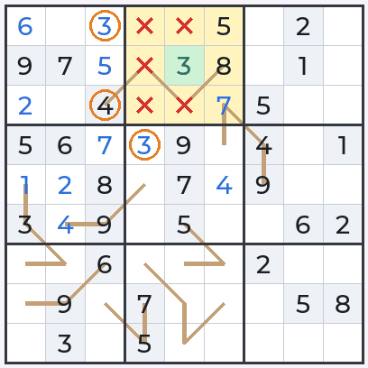

#### Step 13: the 2 in box 2

Box 2 needs a 2. r1c4 and r1c5: row 1 has one (r1c8). r3c4 and r3c5: row 3 has one (r3c1). Only **r2c4** is left: **r2c4 = 2**.

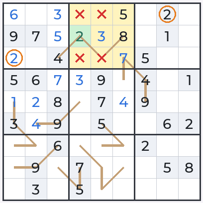

#### Step 14: the 2 in box 5

Box 5 needs a 2. r5c4: row 5 has one (r5c2). r6c4 and r6c6: row 6 has one (r6c9). Only **r4c6** is left: **r4c6 = 2**.

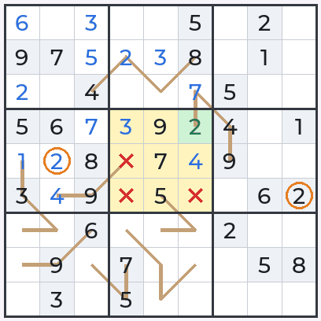

#### Step 15: the 6 in box 5

Box 5 needs a 6. r6c4 and r6c6: row 6 has one (r6c8). Only **r5c4** is left: **r5c4 = 6**.

#### Step 16: the 6 in box 2

Box 2 needs a 6. r1c4 and r1c5: row 1 has one (r1c1). r3c4: column 4 has one (r5c4). Only **r3c5** is left: **r3c5 = 6**.

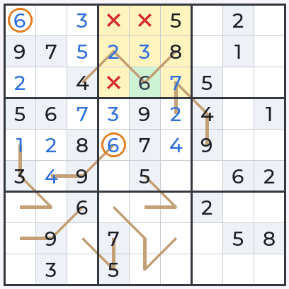

#### Step 17: the 8 in box 5

Box 5 needs an 8. r6c6: column 6 has one (r2c6). Only **r6c4** is left: **r6c4 = 8**.

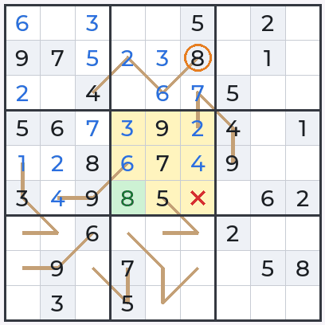

#### Step 18: the 1 in box 5

Box 5 needs a 1, and r6c6 is its last empty cell: **r6c6 = 1**.

#### Step 19: the 5 in box 6

Box 6 needs a 5. r4c8: row 4 has one (r4c1). r5c8: column 8 has one (r8c8). r6c7: row 6 has one (r6c5). Only **r5c9** is left: **r5c9 = 5**.

#### Step 20: the 3 in box 6

Box 6 needs a 3. r4c8: row 4 has one (r4c4). r6c7: row 6 has one (r6c1). Only **r5c8** is left: **r5c8 = 3**.

#### Step 21: the 3 in box 3

Box 3 needs a 3. r1c7 and r1c9: row 1 has one (r1c3). r2c7 and r2c9: row 2 has one (r2c5). r3c8: column 8 has one (r5c8). Only **r3c9** is left: **r3c9 = 3**.

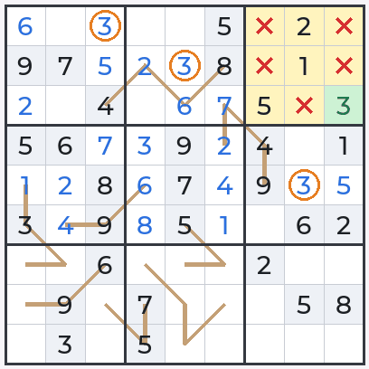

#### Step 22: the 7 in box 6

Box 6 needs a 7. r4c8: row 4 has one (r4c3). Only **r6c7** is left: **r6c7 = 7**.

#### Step 23: the 7 in box 3

Box 3 needs a 7. r1c7: column 7 has one (r6c7). r2c7 and r2c9: row 2 has one (r2c2). r3c8: row 3 has one (r3c6). Only **r1c9** is left: **r1c9 = 7**.

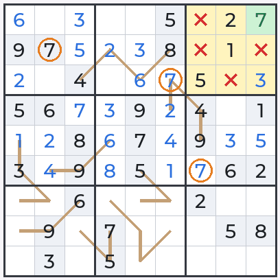

#### Step 24: the 4 in box 3

Box 3 needs a 4. r1c7 and r2c7: column 7 has one (r4c7). r3c8: row 3 has one (r3c3). Only **r2c9** is left: **r2c9 = 4**.

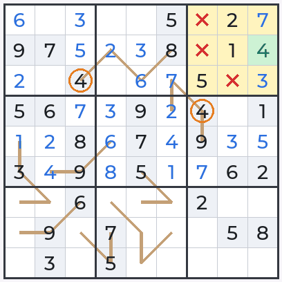

#### Step 25: the 6 in box 3

Box 3 needs a 6. r1c7: row 1 has one (r1c1). r3c8: row 3 has one (r3c5). Only **r2c7** is left: **r2c7 = 6**.

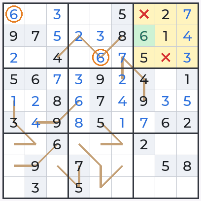

#### Step 26: the 9 in box 3

Box 3 needs a 9. r1c7: column 7 has one (r5c7). Only **r3c8** is left: **r3c8 = 9**.

#### Step 27: the 9 in box 2

Box 2 needs a 9. r1c5: column 5 has one (r4c5). r3c4: row 3 has one (r3c8). Only **r1c4** is left: **r1c4 = 9**.

#### Step 28: the 4 in box 2

Box 2 needs a 4. r3c4: row 3 has one (r3c3). Only **r1c5** is left: **r1c5 = 4**.

#### Step 29: the 1 in box 2

Box 2 needs a 1, and r3c4 is its last empty cell: **r3c4 = 1**.

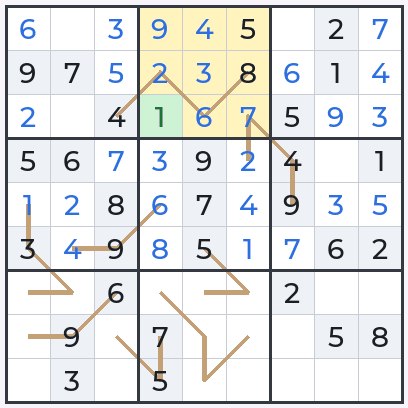

#### Step 30: the 1 in box 1

Box 1 needs a 1. r3c2: row 3 has one (r3c4). Only **r1c2** is left: **r1c2 = 1**.

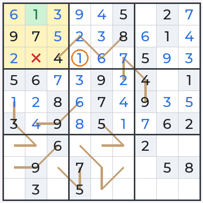

#### Step 31: the 8 in box 1

Box 1 needs an 8, and r3c2 is its last empty cell: **r3c2 = 8**.

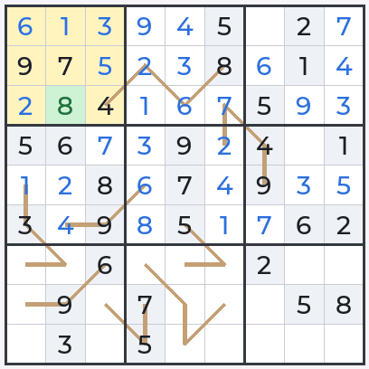

#### Step 32: the 8 in box 3

Box 3 needs an 8, and r1c7 is its last empty cell: **r1c7 = 8**.

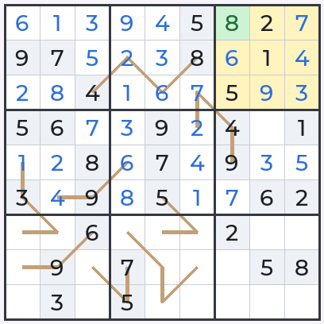

#### Step 33: the 8 in box 6

Box 6 needs an 8, and r4c8 is its last empty cell: **r4c8 = 8**.

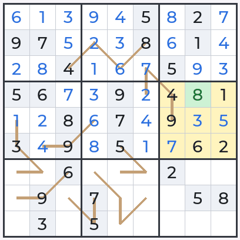

#### Step 34: the 5 in box 7

Box 7 needs a 5. r7c1: column 1 has one (r4c1). r8c1 and r8c3: row 8 has one (r8c8). r9c1 and r9c3: row 9 has one (r9c4). Only **r7c2** is left: **r7c2 = 5**.

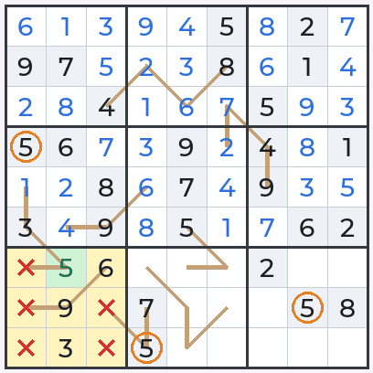

#### Step 35: the 4 in box 8

Box 8 needs a 4. r7c5, r8c5 and r9c5: column 5 has one (r1c5). r7c6, r8c6 and r9c6: column 6 has one (r5c6). Only **r7c4** is left: **r7c4 = 4**.

#### Step 36: the 3 in box 8

Box 8 needs a 3. r7c5 and r8c5: column 5 has one (r2c5). r9c5 and r9c6: row 9 has one (r9c2). r8c6: the 4 in r7c4 is on its brown line too, and 3 is 1 away from it. Only **r7c6** is left: **r7c6 = 3**.

#### Step 37: the 9 in box 8

Box 8 needs a 9. r7c5 and r9c5: column 5 has one (r4c5). r8c5 and r8c6: row 8 has one (r8c2). Only **r9c6** is left: **r9c6 = 9**.

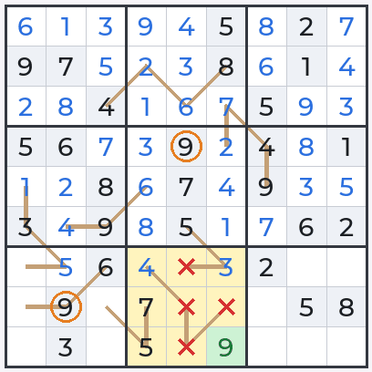

#### Step 38: the 6 in box 8

Box 8 needs a 6. r7c5: row 7 has one (r7c3). r8c5 and r9c5: column 5 has one (r3c5). Only **r8c6** is left: **r8c6 = 6**.

#### Step 39: the 3 in box 9

Box 9 needs a 3. r7c8 and r7c9: row 7 has one (r7c6). r9c7, r9c8 and r9c9: row 9 has one (r9c2). Only **r8c7** is left: **r8c7 = 3**.

#### Step 40: the 1 in box 9

Box 9 needs a 1. r7c8 and r9c8: column 8 has one (r2c8). r7c9 and r9c9: column 9 has one (r4c9). Only **r9c7** is left: **r9c7 = 1**.

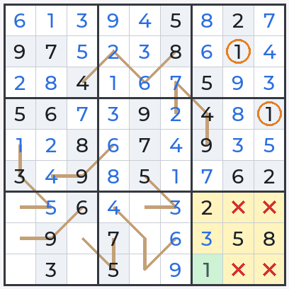

#### Step 41: the 1 in box 7

Box 7 needs a 1. r7c1 and r8c1: column 1 has one (r5c1). r9c1 and r9c3: row 9 has one (r9c7). Only **r8c3** is left: **r8c3 = 1**.

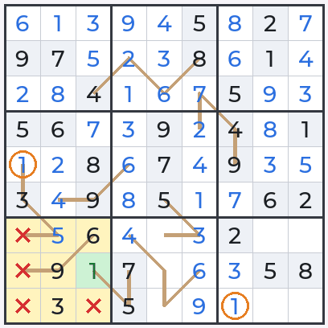

#### Step 42: the 2 in box 7

Box 7 needs a 2. r7c1: row 7 has one (r7c7). r8c1 and r9c1: column 1 has one (r3c1). Only **r9c3** is left: **r9c3 = 2**.

#### Step 43: the 1 in box 8

Box 8 needs a 1. r8c5: row 8 has one (r8c3). r9c5: row 9 has one (r9c7). Only **r7c5** is left: **r7c5 = 1**.

#### Step 44: the 2 in box 8

Box 8 needs a 2. r9c5: row 9 has one (r9c3). Only **r8c5** is left: **r8c5 = 2**.

#### Step 45: the 8 in box 8

Box 8 needs an 8, and r9c5 is its last empty cell: **r9c5 = 8**.

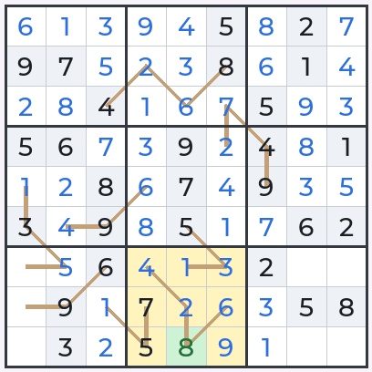

#### Step 46: the 8 in box 7

Box 7 needs an 8. r8c1: row 8 has one (r8c9). r9c1: row 9 has one (r9c5). Only **r7c1** is left: **r7c1 = 8**.

#### Step 47: the 7 in box 7

Box 7 needs a 7. r8c1: row 8 has one (r8c4). Only **r9c1** is left: **r9c1 = 7**.

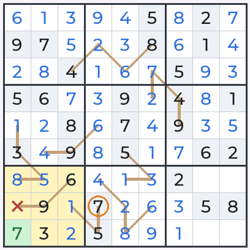

#### Step 48: the 4 in box 7

Box 7 needs a 4, and r8c1 is its last empty cell: **r8c1 = 4**.

#### Step 49: the 4 in box 9

Box 9 needs a 4. r7c8 and r7c9: row 7 has one (r7c4). r9c9: column 9 has one (r2c9). Only **r9c8** is left: **r9c8 = 4**.

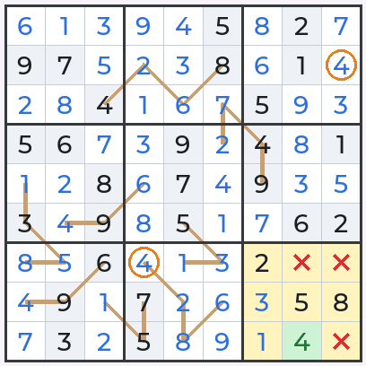

#### Step 50: the 6 in box 9

Box 9 needs a 6. r7c8 and r7c9: row 7 has one (r7c3). Only **r9c9** is left: **r9c9 = 6**.

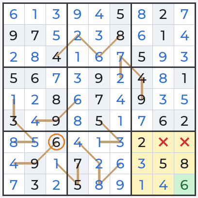

#### Step 51: the 7 in box 9

Box 9 needs a 7. r7c9: column 9 has one (r1c9). Only **r7c8** is left: **r7c8 = 7**.

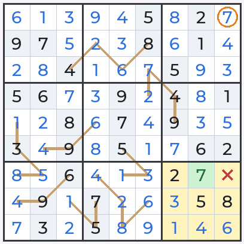

#### Step 52: the 9 in box 9

Box 9 needs a 9, and r7c9 is its last empty cell: **r7c9 = 9**.

Solved.

<!-- /walkthrough -->
