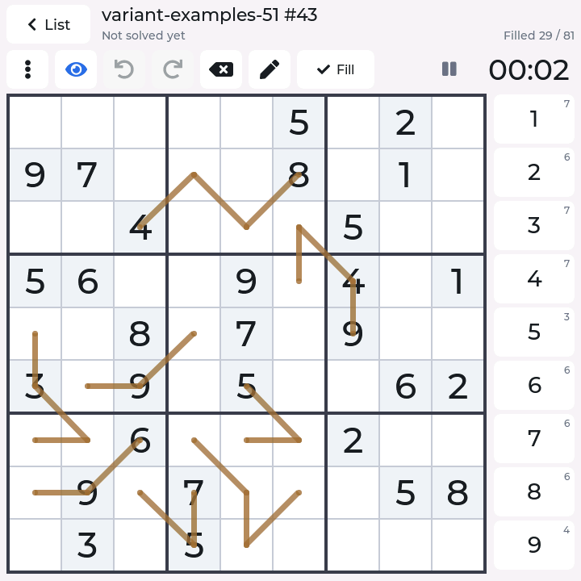

# Nabner

[← All variants](README.md) · [Puzzles](../features-puzzles.md) · [How to play](../how-to-play.md)

## The rules

[Classic](classic.md) rules, and **brown lines**: no two digits on a line are **the same or 1 apart**. That's every two digits on the line, not just neighbours: 1, 4, 8, 6 is fine (the closest pair, 8 and 6, is 2 apart), but 1, 4, 8, 3 isn't (4 and 3). A line has 3 to 5 cells: no six digits are all 2 or more apart.

## On the board

- The lines are drawn in brown, through the cell centres; lines don't cross each other.
- Two digits on a line that are the same or 1 apart turn red.
- The grader and hints treat a line as a set of digits that keep their distance: "No two digits on this line are the same or 1 apart, so row 4, column 6 can only be 2."
- **Puzzles → ⋮ → New puzzle → Lines → Nabner**: 8 lines (Hard and Expert: 10).

## How to solve it

- **Each digit on a line rules out itself and its neighbours** for every other cell of that line: a 5 leaves only 1 to 3 and 7 to 9.
- **A long line is a tight fit:** five cells need five digits all 2 apart, and only 1, 3, 5, 7, 9 do that: a 5-cell line is all odd. Four cells leave a few more sets (1, 3, 5, 7 or 2, 4, 6, 9 ...).
- **Low and high split:** a 4 and a 6 on one line leave no room for 3, 5 or 7 anywhere on it.

## Worked example

**variant-examples #43**, Nabner Easy (see [Classic](classic.md#worked-example-the-whole-puzzle) for how to import the examples; cells are written r*row*c*column*).

**Step 1: r4c6.** Row 4 has 5, 6, 9, 4 and 1; box 5 has the 7 in r5c5 and column 6 the 8 in r2c6: that leaves 2 and 3. r4c6 is on a line with r3c6, the 4 in r4c7 and the 9 in r5c7, and 3 is 1 away from that 4. **r4c6 = 2**.

**Step 2: r5c1.** Column 1 has 9, 5 and 3; row 5 has 8, 7 and 9; box 4 has 6: that leaves 1, 2 and 4. r5c1 is on a line with r7c1, r7c2 and the 3 in r6c1: 2 and 4 are both 1 away from it. **r5c1 = 1**.

**Step 3: r2c3**, by the Classic rules alone: box 1 needs a 5, rows 1 and 3 have one (r1c6, r3c7) and r2c1, r2c2 and r3c3 are filled. **r2c3 = 5**.

## The whole puzzle, step by step

<!-- walkthrough -->
<!-- Written by tools/walkthrough.py nabner: edit the script, not this part. -->

The whole puzzle, from the start to the last cell: 52 steps, each one a single (one place left for a digit, or one digit left for a cell), taken in the order a box's single comes first, so not quite the order of the worked example above. Each step has a page of its own, with **Previous** and **Next**: pick its number below. In each picture, the unit the step looks at is tinted yellow (for a cell with one digit left: its row, column and box), the new digit is on green, the digits that rule cells out have an **orange ring**, and the empty cells they rule out a **red cross**. Givens are on grey, digits from earlier steps in blue.

| [1](nabner/step-01.md) | [2](nabner/step-02.md) | [3](nabner/step-03.md) | [4](nabner/step-04.md) | [5](nabner/step-05.md) | [6](nabner/step-06.md) | [7](nabner/step-07.md) | [8](nabner/step-08.md) | [9](nabner/step-09.md) | [10](nabner/step-10.md) |
|:-:|:-:|:-:|:-:|:-:|:-:|:-:|:-:|:-:|:-:|
| [11](nabner/step-11.md) | [12](nabner/step-12.md) | [13](nabner/step-13.md) | [14](nabner/step-14.md) | [15](nabner/step-15.md) | [16](nabner/step-16.md) | [17](nabner/step-17.md) | [18](nabner/step-18.md) | [19](nabner/step-19.md) | [20](nabner/step-20.md) |
| [21](nabner/step-21.md) | [22](nabner/step-22.md) | [23](nabner/step-23.md) | [24](nabner/step-24.md) | [25](nabner/step-25.md) | [26](nabner/step-26.md) | [27](nabner/step-27.md) | [28](nabner/step-28.md) | [29](nabner/step-29.md) | [30](nabner/step-30.md) |
| [31](nabner/step-31.md) | [32](nabner/step-32.md) | [33](nabner/step-33.md) | [34](nabner/step-34.md) | [35](nabner/step-35.md) | [36](nabner/step-36.md) | [37](nabner/step-37.md) | [38](nabner/step-38.md) | [39](nabner/step-39.md) | [40](nabner/step-40.md) |
| [41](nabner/step-41.md) | [42](nabner/step-42.md) | [43](nabner/step-43.md) | [44](nabner/step-44.md) | [45](nabner/step-45.md) | [46](nabner/step-46.md) | [47](nabner/step-47.md) | [48](nabner/step-48.md) | [49](nabner/step-49.md) | [50](nabner/step-50.md) |
| [51](nabner/step-51.md) | [52](nabner/step-52.md) |  |  |  |  |  |  |  |  |

Solved.

<!-- /walkthrough -->
