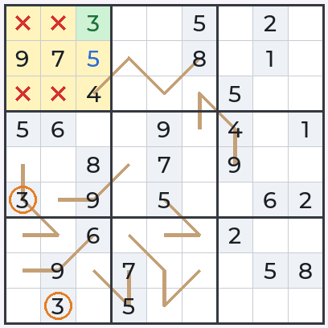

<!-- Written by tools/walkthrough.py nabner: edit the script, not this page. -->
# Nabner, step 2: the 3 in box 1

**Step 2 of 52** · [← Step 1](step-01.md) · [All steps](../nabner.md#the-whole-puzzle-step-by-step) · [Step 3 →](step-03.md)

Box 1 needs a 3. r1c1 and r3c1: column 1 has one (r6c1). r1c2 and r3c2: column 2 has one (r9c2). Only **r1c3** is left: **r1c3 = 3**.

**Step 2 of 52** · [← Step 1](step-01.md) · [All steps](../nabner.md#the-whole-puzzle-step-by-step) · [Step 3 →](step-03.md)
