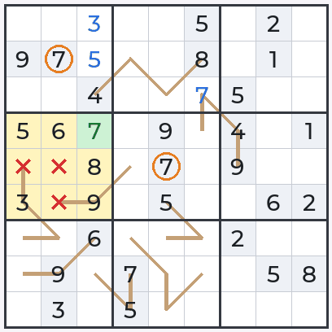

<!-- Written by tools/walkthrough.py nabner: edit the script, not this page. -->
# Nabner, step 4: the 7 in box 4

**Step 4 of 52** · [← Step 3](step-03.md) · [All steps](../nabner.md#the-whole-puzzle-step-by-step) · [Step 5 →](step-05.md)

Box 4 needs a 7. r5c1 and r5c2: row 5 has one (r5c5). r6c2: column 2 has one (r2c2). Only **r4c3** is left: **r4c3 = 7**.

**Step 4 of 52** · [← Step 3](step-03.md) · [All steps](../nabner.md#the-whole-puzzle-step-by-step) · [Step 5 →](step-05.md)
