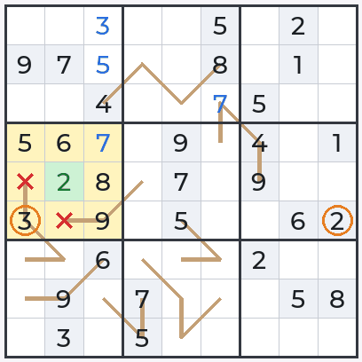

<!-- Written by tools/walkthrough.py nabner: edit the script, not this page. -->
# Nabner, step 5: the 2 in box 4

**Step 5 of 52** · [← Step 4](step-04.md) · [All steps](../nabner.md#the-whole-puzzle-step-by-step) · [Step 6 →](step-06.md)

Box 4 needs a 2. r6c2: row 6 has one (r6c9). r5c1: the 3 in r6c1 is on its brown line too, and 2 is 1 away from it. Only **r5c2** is left: **r5c2 = 2**.

**Step 5 of 52** · [← Step 4](step-04.md) · [All steps](../nabner.md#the-whole-puzzle-step-by-step) · [Step 6 →](step-06.md)
