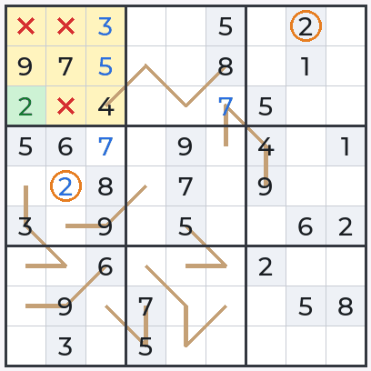

<!-- Written by tools/walkthrough.py nabner: edit the script, not this page. -->
# Nabner, step 6: the 2 in box 1

**Step 6 of 52** · [← Step 5](step-05.md) · [All steps](../nabner.md#the-whole-puzzle-step-by-step) · [Step 7 →](step-07.md)

Box 1 needs a 2. r1c1 and r1c2: row 1 has one (r1c8). r3c2: column 2 has one (r5c2). Only **r3c1** is left: **r3c1 = 2**.

**Step 6 of 52** · [← Step 5](step-05.md) · [All steps](../nabner.md#the-whole-puzzle-step-by-step) · [Step 7 →](step-07.md)
