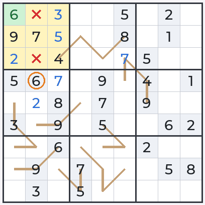

<!-- Written by tools/walkthrough.py nabner: edit the script, not this page. -->
# Nabner, step 7: the 6 in box 1

**Step 7 of 52** · [← Step 6](step-06.md) · [All steps](../nabner.md#the-whole-puzzle-step-by-step) · [Step 8 →](step-08.md)

Box 1 needs a 6. r1c2 and r3c2: column 2 has one (r4c2). Only **r1c1** is left: **r1c1 = 6**.

**Step 7 of 52** · [← Step 6](step-06.md) · [All steps](../nabner.md#the-whole-puzzle-step-by-step) · [Step 8 →](step-08.md)
