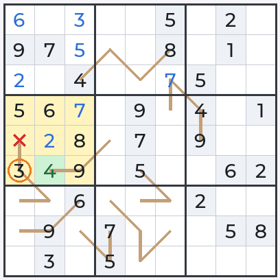

<!-- Written by tools/walkthrough.py nabner: edit the script, not this page. -->
# Nabner, step 8: the 4 in box 4

**Step 8 of 52** · [← Step 7](step-07.md) · [All steps](../nabner.md#the-whole-puzzle-step-by-step) · [Step 9 →](step-09.md)

Box 4 needs a 4. r5c1: the 3 in r6c1 is on its brown line too, and 4 is 1 away from it. Only **r6c2** is left: **r6c2 = 4**.

**Step 8 of 52** · [← Step 7](step-07.md) · [All steps](../nabner.md#the-whole-puzzle-step-by-step) · [Step 9 →](step-09.md)
