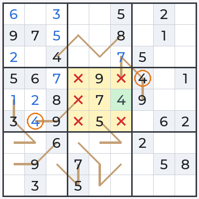

<!-- Written by tools/walkthrough.py nabner: edit the script, not this page. -->
# Nabner, step 10: the 4 in box 5

**Step 10 of 52** · [← Step 9](step-09.md) · [All steps](../nabner.md#the-whole-puzzle-step-by-step) · [Step 11 →](step-11.md)

Box 5 needs a 4. r4c4 and r4c6: row 4 has one (r4c7). r6c4 and r6c6: row 6 has one (r6c2). r5c4: the 4 in r6c2 is on its brown line already, and no digit repeats on it. Only **r5c6** is left: **r5c6 = 4**.

**Step 10 of 52** · [← Step 9](step-09.md) · [All steps](../nabner.md#the-whole-puzzle-step-by-step) · [Step 11 →](step-11.md)
