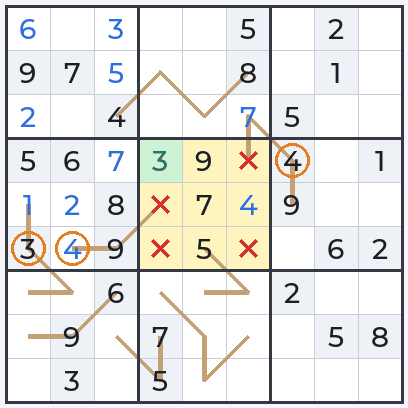

<!-- Written by tools/walkthrough.py nabner: edit the script, not this page. -->
# Nabner, step 11: the 3 in box 5

**Step 11 of 52** · [← Step 10](step-10.md) · [All steps](../nabner.md#the-whole-puzzle-step-by-step) · [Step 12 →](step-12.md)

Box 5 needs a 3. r6c4 and r6c6: row 6 has one (r6c1). r4c6: the 4 in r4c7 is on its brown line too, and 3 is 1 away from it. r5c4: the 4 in r6c2 is on its brown line too, and 3 is 1 away from it. Only **r4c4** is left: **r4c4 = 3**.

**Step 11 of 52** · [← Step 10](step-10.md) · [All steps](../nabner.md#the-whole-puzzle-step-by-step) · [Step 12 →](step-12.md)
