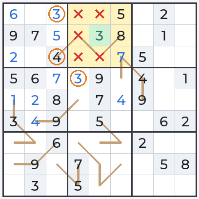

<!-- Written by tools/walkthrough.py nabner: edit the script, not this page. -->
# Nabner, step 12: the 3 in box 2

**Step 12 of 52** · [← Step 11](step-11.md) · [All steps](../nabner.md#the-whole-puzzle-step-by-step) · [Step 13 →](step-13.md)

Box 2 needs a 3. r1c4 and r1c5: row 1 has one (r1c3). r2c4 and r3c4: column 4 has one (r4c4). r3c5: the 4 in r3c3 is on its brown line too, and 3 is 1 away from it. Only **r2c5** is left: **r2c5 = 3**.

**Step 12 of 52** · [← Step 11](step-11.md) · [All steps](../nabner.md#the-whole-puzzle-step-by-step) · [Step 13 →](step-13.md)
