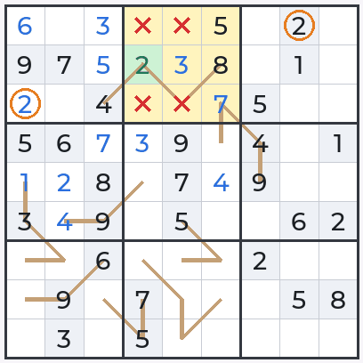

<!-- Written by tools/walkthrough.py nabner: edit the script, not this page. -->
# Nabner, step 13: the 2 in box 2

**Step 13 of 52** · [← Step 12](step-12.md) · [All steps](../nabner.md#the-whole-puzzle-step-by-step) · [Step 14 →](step-14.md)

Box 2 needs a 2. r1c4 and r1c5: row 1 has one (r1c8). r3c4 and r3c5: row 3 has one (r3c1). Only **r2c4** is left: **r2c4 = 2**.

**Step 13 of 52** · [← Step 12](step-12.md) · [All steps](../nabner.md#the-whole-puzzle-step-by-step) · [Step 14 →](step-14.md)
