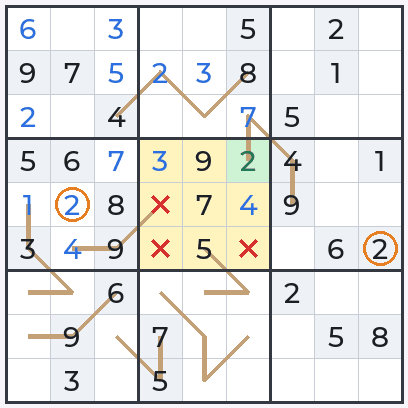

<!-- Written by tools/walkthrough.py nabner: edit the script, not this page. -->
# Nabner, step 14: the 2 in box 5

**Step 14 of 52** · [← Step 13](step-13.md) · [All steps](../nabner.md#the-whole-puzzle-step-by-step) · [Step 15 →](step-15.md)

Box 5 needs a 2. r5c4: row 5 has one (r5c2). r6c4 and r6c6: row 6 has one (r6c9). Only **r4c6** is left: **r4c6 = 2**.

**Step 14 of 52** · [← Step 13](step-13.md) · [All steps](../nabner.md#the-whole-puzzle-step-by-step) · [Step 15 →](step-15.md)
