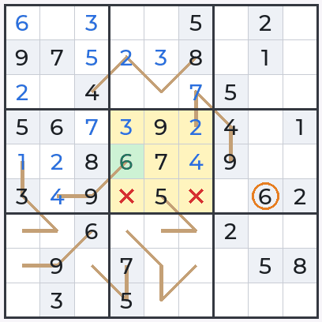

<!-- Written by tools/walkthrough.py nabner: edit the script, not this page. -->
# Nabner, step 15: the 6 in box 5

**Step 15 of 52** · [← Step 14](step-14.md) · [All steps](../nabner.md#the-whole-puzzle-step-by-step) · [Step 16 →](step-16.md)

Box 5 needs a 6. r6c4 and r6c6: row 6 has one (r6c8). Only **r5c4** is left: **r5c4 = 6**.

**Step 15 of 52** · [← Step 14](step-14.md) · [All steps](../nabner.md#the-whole-puzzle-step-by-step) · [Step 16 →](step-16.md)
