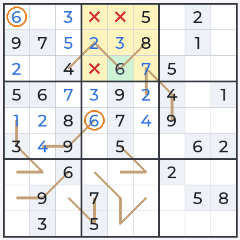

<!-- Written by tools/walkthrough.py nabner: edit the script, not this page. -->
# Nabner, step 16: the 6 in box 2

**Step 16 of 52** · [← Step 15](step-15.md) · [All steps](../nabner.md#the-whole-puzzle-step-by-step) · [Step 17 →](step-17.md)

Box 2 needs a 6. r1c4 and r1c5: row 1 has one (r1c1). r3c4: column 4 has one (r5c4). Only **r3c5** is left: **r3c5 = 6**.

**Step 16 of 52** · [← Step 15](step-15.md) · [All steps](../nabner.md#the-whole-puzzle-step-by-step) · [Step 17 →](step-17.md)
