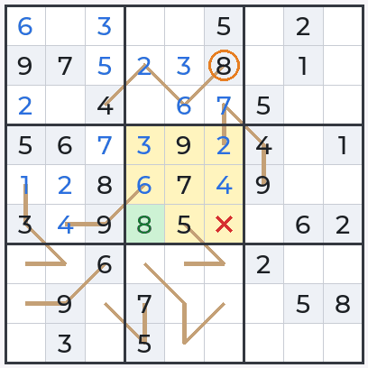

<!-- Written by tools/walkthrough.py nabner: edit the script, not this page. -->
# Nabner, step 17: the 8 in box 5

**Step 17 of 52** · [← Step 16](step-16.md) · [All steps](../nabner.md#the-whole-puzzle-step-by-step) · [Step 18 →](step-18.md)

Box 5 needs an 8. r6c6: column 6 has one (r2c6). Only **r6c4** is left: **r6c4 = 8**.

**Step 17 of 52** · [← Step 16](step-16.md) · [All steps](../nabner.md#the-whole-puzzle-step-by-step) · [Step 18 →](step-18.md)
